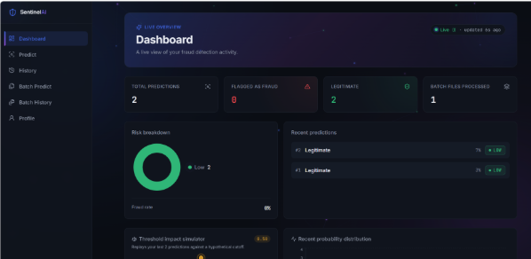
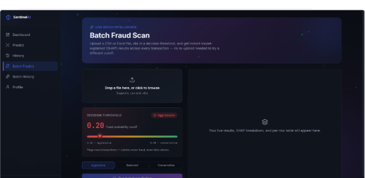

<div align="center">

# Hi, I'm Pranshul Khokhar 👋

### AI/ML Engineer — Backend, Applied ML & RAG Systems

I build production-style ML and LLM systems end to end: model / retrieval pipeline → API → the interface people actually use.

[](https://sentinel-ai-six-nu.vercel.app)
[](https://github.com/pransh966/RepoMind)
[](https://www.linkedin.com/in/pranshul-khokhar-12072005pransh/)
[](mailto:pranshulkhokhar@gmail.com)

</div>

---

### About me

AI/ML undergraduate (B.Tech, GGSIPU, 2023–2027) who likes finishing what I start — that means the model actually gets served behind an API, and the API actually gets a real interface, not just a notebook and a metric. I currently build two full production-style systems: **SentinelAI**, a fraud detection platform with live SHAP explainability, and **RepoMind**, a retrieval-augmented (RAG) assistant that answers questions about a codebase with citations back to the exact file and line. Comfortable across the stack: Python, FastAPI, PostgreSQL, React, and the retrieval/embedding layer that sits under most real LLM products.

- 🔭 Currently building: **RepoMind** — AST-aware RAG over codebases, and **SentinelAI** — real-time + batch fraud detection
- 🌱 Currently deepening: production ML system design, retrieval architecture, and model monitoring
- 💬 Ask me about: LightGBM/scikit-learn pipelines, SHAP explainability, FastAPI backends, FAISS retrieval, RAG system design
- ⚡ Fun fact: ranked Top 10 of 100+ teams in a 24-hour hackathon

---

### 🛡️ Featured project — SentinelAI

**AI-powered fraud detection platform** — real-time transaction scoring, batch analysis, and per-prediction explainability. Trained on the IEEE-CIS Fraud Detection dataset (~590K transactions, 424 engineered features), served through FastAPI, with a React dashboard for scoring, batch analysis, and history.

**What makes it more than a tutorial project:**
- Live decision threshold slider (0.10–0.90) with Aggressive/Balanced/Conservative presets — see precision/recall trade-offs instantly, no retraining
- Per-transaction **SHAP explainability**, row-aware for batch uploads, plus an aggregate "what's driving fraud risk" view
- Searchable, filterable, sortable batch results table with per-row SHAP inspection
- Honest metrics — precision/recall surfaced explicitly, not a misleading accuracy number, since the data is ~3.5% fraud
- Live-updating dashboard: trend, probability distribution, risk breakdown, threshold impact simulator

<table>
<tr>
<td width="50%"></td>
<td width="50%"></td>
</tr>
</table>

**Stack:** LightGBM · scikit-learn · SHAP · FastAPI · PostgreSQL (Neon) · React 19 · Tailwind · Recharts
**Deployed on:** Vercel (frontend) + Render (backend)

🔗 **[Live demo](https://sentinel-ai-six-nu.vercel.app)** — free, no setup, register and try it
📄 **[API docs](https://sentinel-ai5.onrender.com/docs)**

---

### 🧠 Featured project — RepoMind

**A codebase-aware RAG assistant** — point it at a repo and ask questions about the code in plain English; every answer is grounded in the actual source and cited down to the file and line range it came from.

```
repo files --> AST-aware chunking --> local embeddings --> FAISS index
                                                                 |
user question --> embed --> retrieve top-k --> LLM (grounded prompt) --> answer + citations
```

**What makes it more than a "chat with your docs" tutorial:**
- **AST-aware chunking, not fixed-size windows.** Most RAG tutorials split text every N characters, routinely cutting a function in half mid-body. RepoMind parses Python with the `ast` module and chunks at function/class boundaries, so retrieval returns whole, coherent units of code — non-Python files fall back to a structure-aware sliding window instead of a blind character count.
- **Grounded answers, not just retrieval.** The system prompt explicitly instructs the model to answer only from retrieved context and say so when it can't — an actual mechanism to reduce hallucination, not just a claim.
- **Local embeddings, pluggable generation.** Embedding runs locally via `sentence-transformers` — free, fast, works offline. Only the final answer-generation call needs a paid API key, and that provider is swappable (OpenAI / Anthropic / a zero-key mock for local dev and tests).
- **Full accounts system**, not a single-user script — JWT auth, per-user repos and query history in PostgreSQL, connect a repo by git URL or `.zip` upload, each repo gets its own FAISS index.
- **A real (if simple) rate limiter**, and a documented, honest list of what would need to change to scale it (swap `IndexFlatIP` for `IndexHNSWFlat`, move state out of process, add streaming) — written up in the repo rather than glossed over.

**Measured, not invented:** I benchmarked the ingestion pipeline against a real open-source repo (`psf/requests`) rather than making up numbers — 37 files scanned into 254 AST-aware chunks in ~62ms on a single process, no GPU.

**Stack:** Python · FastAPI · FAISS · sentence-transformers · PostgreSQL · JWT · OpenAI/Anthropic-pluggable LLM layer · Docker
**Status:** repo is public and fully documented; the hosted demo is temporarily down while I move the embedding model out of the deploy image — the free-tier container limit is 512MB and the current image (embedding model + FAISS + deps) goes over that. Swapping to a smaller quantized model / lazy-loading the model at first request instead of at build time.

🔗 **[Source & full README](https://github.com/pransh966/RepoMind)** — setup, API reference, architecture notes, and honest limitations are all documented there

---

### 🧰 Skills & tools

**Languages**


**Machine Learning**


**Retrieval & LLM systems**


**Data**


**Backend**


**Frontend**


**Deployment & Tools**


---

### 📌 More projects

**Cinematch — Movie Recommendation System** — `Python · FastAPI · FAISS · Vanilla JS`
Embedding-based recommendation engine across 100,000+ ratings, 1,600+ movies, and 900+ users, using FAISS for approximate nearest-neighbor retrieval (0.71 avg top-1 / 0.64 avg top-5 cosine similarity on held-out queries). Rebuilt from an original Streamlit notebook app into a real FastAPI service + framework-free JS frontend: the TMDB key moved server-side out of source control, recommendation logic separated from presentation, an in-process response cache added, and a `/health` endpoint that reports real service status instead of failing silently.

**Social Media REST API** — `FastAPI · PostgreSQL · SQLAlchemy · JWT`
RESTful backend with JWT authentication, post management, and voting. Secure password hashing, Pydantic request validation, PostgreSQL schemas via SQLAlchemy ORM, interactive docs via Swagger UI and ReDoc.

---

### 📊 GitHub stats

<div align="center">


</div>

---

<div align="center">

📫 **Reach me:** [pranshulkhokhar@gmail.com](mailto:pranshulkhokhar@gmail.com) · [LinkedIn](https://www.linkedin.com/in/pranshul-khokhar-12072005pransh/) · [SentinelAI live demo](https://sentinel-ai-six-nu.vercel.app) · [RepoMind repo](https://github.com/pransh966/RepoMind)

</div>
